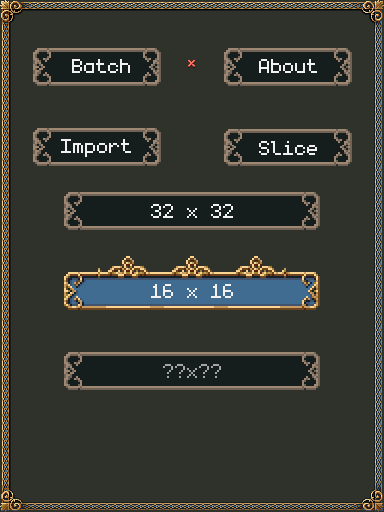
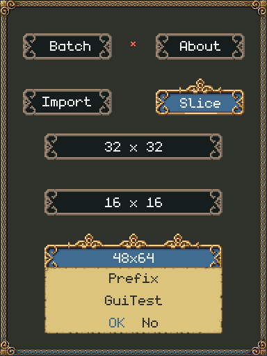
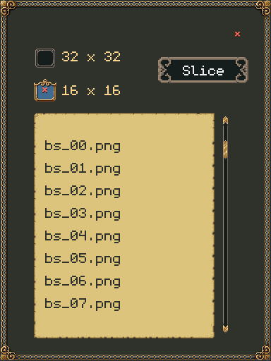
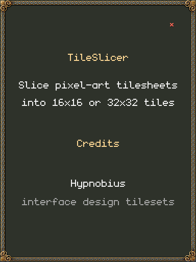

<p align="center">
  
</p>

<h1 align="center">TileSlicer</h1>

<p align="center">
  A tiny pixel-art tile slicer for Windows — cut any tilesheet into
  ready-to-use 16×16, 32×32 or custom tiles.
</p>

---

## About

TileSlicer is a small desktop tool for game artists and hobbyist devs. Drop in
a tilesheet, pick a tile size, and it writes every tile out as its own neatly
named PNG — ready to import into a game engine, an asset pipeline, or a map
editor.

The entire interface is drawn from (and looks like) a pixel-art RPG window —
so much so that it has no OS title bar; drag it around by its border or any
empty spot. Under the hood it is plain Python + Tkinter + Pillow.

## Features

- **Import** — slice a single image.
- **Batch** — load many images at once into a scrollable list; `Slice` cuts
  them all in one pass.
- **16×16 / 32×32 / custom sizes** — pick a banner, or type any size (e.g.
  `24x24`) into the custom box.
- **Neatly named exports** — `Prefix_Row3_Column7_32x32.png`, numbered from the
  top-left. The prefix defaults to the file name and is only asked for when two
  files would produce identical names.
- **Nothing to configure** — results land in an `Export` folder next to the
  app.
- **Portable or installable** — a single portable exe, or a normal Windows
  installer.

## Screenshots

| Main window | Slice asks for a prefix |
| --- | --- |
|  |  |

| Batch mode | About |
| --- | --- |
|  |  |

## Getting started

Download the portable zip or the installer from the
[Releases](../../releases) page, then:

1. **Import** an image (or **Batch** several at once).
2. Click a banner to choose the tile size — `32x32`, `16x16`, or type a custom
   size like `24x24` into the `??x??` box.
3. Press **Slice**, type a prefix, done — the tiles appear in `Export\`.

### Run from source

```
python -m pip install -r requirements.txt
python TileSlicerGUI.py
```

Requires Python 3.8+ with Tkinter (included in the python.org Windows
installer).

### Build the exe yourself

```
python -m pip install pyinstaller
python -m PyInstaller --onefile --noconsole --name TileSlicer --icon "Assets\TileSlicer.ico" --add-data "Assets;Assets" TileSlicerGUI.py
```

The result is `dist\TileSlicer.exe` — self-contained, writes its `Export`
folder next to itself.

## Credits

- Interface design tilesets by **Hypnobius** — the frames, buttons, banners
  and parchment the whole UI is dressed in.
- Built with [Python](https://www.python.org),
  [Tkinter](https://docs.python.org/3/library/tkinter.html) and
  [Pillow](https://python-pillow.org).
- App icon: `Assets/TileSlicer.svg`.

## License

The code is released under the MIT license — see [LICENSE](LICENSE).
The art in `Assets/` is not covered by the MIT license and remains the
property of its authors.
